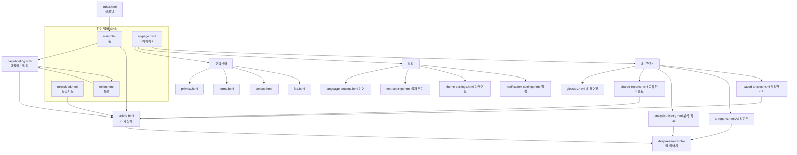
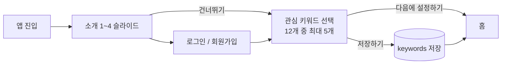
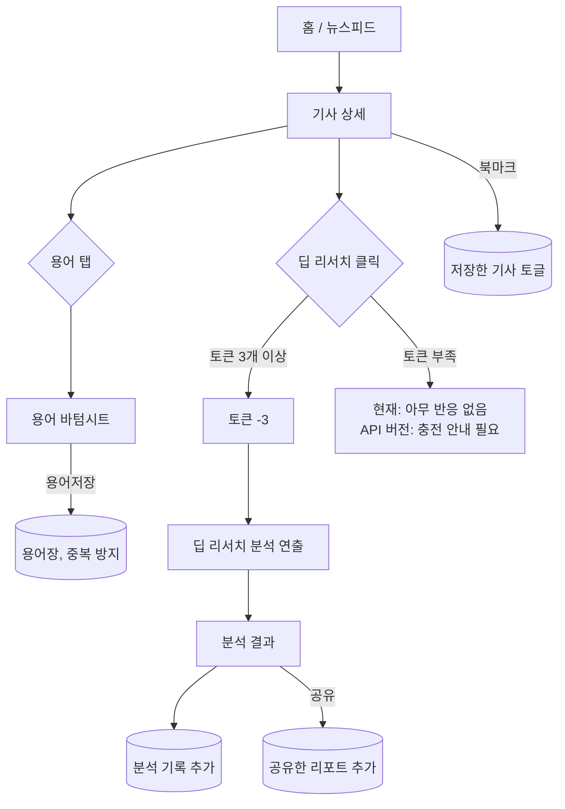
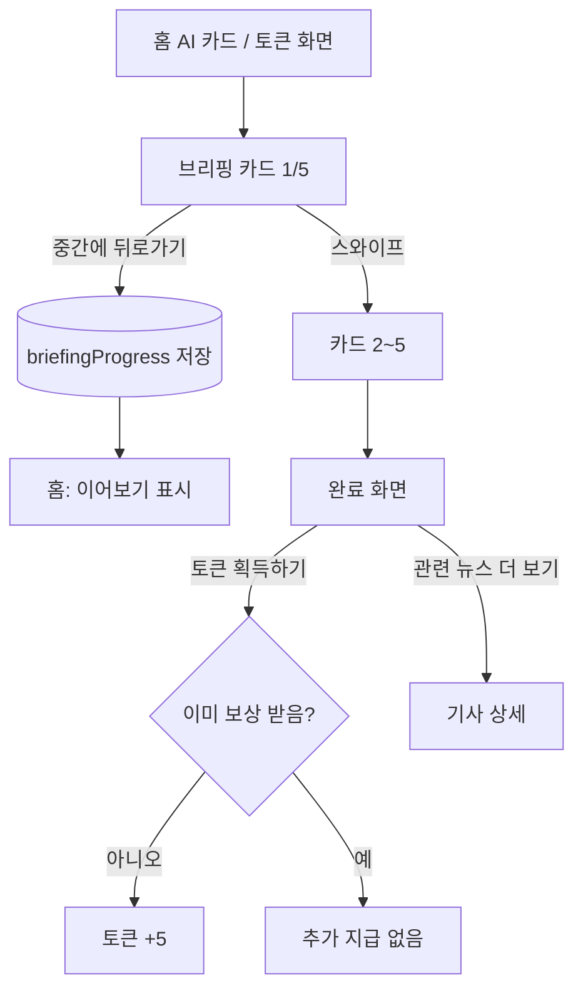
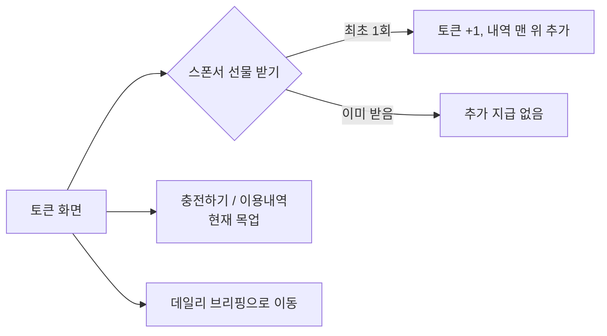
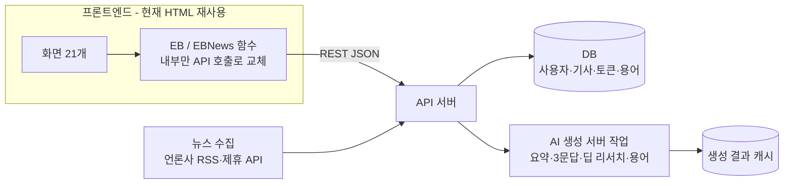
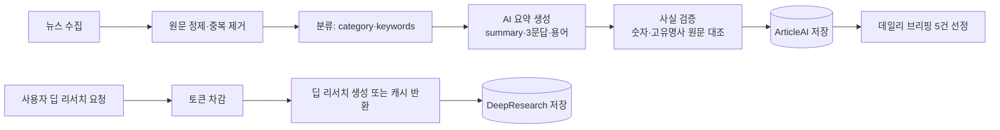

# EconomyBrief 기획서 (역기획 · 개발 기준 문서)

> **이 문서는 무엇인가**
> 현재 저장소(와이어프레임 v2)에 구현된 화면과 코드를 거꾸로 분석해서 정리한 기획서다.
> API 연동 버전을 개발할 때 **"무엇을, 어떤 데이터로, 어떤 순서로 만들지"**의 기준으로 사용한다.
>
> - 기준 커밋: `chore: gather all markdown docs into md/` (2026-11-18)
> - 작성 방식: 코드·화면·`md/specs`·`md/design-system` 분석
> - 표기 규칙: 코드에서 확인한 사실은 그대로 적고, 코드만으로 확정할 수 없는 기획 의도는 **`(추정)`**으로 표시한다.

---

## 목차

1. [서비스 개요](#1-서비스-개요)
2. [타깃 사용자](#2-타깃-사용자)
3. [핵심 기능 정의](#3-핵심-기능-정의)
4. [정보 구조 (IA)](#4-정보-구조-ia)
5. [사용자 흐름](#5-사용자-흐름)
6. [토큰 정책](#6-토큰-정책)
7. [현재 데이터 구조 (와이어프레임)](#7-현재-데이터-구조-와이어프레임)
8. [API 전환 계획](#8-api-전환-계획)
9. [현재 구현과 기획의 차이 (전환 시 결정 필요)](#9-현재-구현과-기획의-차이-전환-시-결정-필요)

---

## 1. 서비스 개요

| 항목 | 내용 |
|---|---|
| 서비스명 | 이코노미브리프 (Economy Brief) |
| 한 줄 정의 | **AI가 어려운 경제 뉴스를 핵심만 요약하고, 용어 설명과 심층 분석까지 제공하는 모바일 경제 뉴스 앱** |
| 플랫폼 | 모바일 웹앱 (기준 화면 402px, 데스크톱에서는 가운데 한 컬럼) |
| 현재 단계 | 포트폴리오용 와이어프레임 (정적 HTML/CSS/JS, API 없음) |
| 다음 단계 | 실제 뉴스 데이터 + AI 생성 + 사용자 계정을 붙인 API 버전 |

### 1.1 해결하려는 문제

온보딩 화면 문구에서 도출한 서비스 가치:

| 사용자 문제 | 서비스 해결책 | 근거 화면 |
|---|---|---|
| 경제 뉴스가 너무 많고 길다 | **AI 핵심 요약** — 기사당 3~4줄 요약 + "무슨 일/왜 중요/앞으로" 3문답 | 온보딩 1, `article.html` |
| 경제 용어가 어렵다 | **용어 팝업 + 내 용어장** — 본문 속 용어를 눌러 설명 보기·저장 | 온보딩 2, `article.html`, `glossary.html` |
| 시장에 어떤 영향인지 모르겠다 | **딥 리서치** — 결론·경제적 영향·전망·리스크 분석 (토큰 사용) | 온보딩 3, `deep-research.html` |
| 내 관심 분야만 보고 싶다 | **관심 키워드 맞춤 뉴스** | 온보딩 4, `main.html` |
| 매일 꾸준히 보기 어렵다 | **데일리 브리핑 + 토큰 보상** — 5건 카드 스와이프 완료 시 토큰 지급 | `daily-briefing.html`, `token.html` |

### 1.2 서비스 원칙 (화면 문구 기준)

- "AI로 쉽고 **편향되지 않은** 뉴스를 작성합니다."
- "**교차검증**으로 정보의 신뢰성을 확인합니다."
- AI 문장은 기사에 있는 정보만 사용하고 숫자·사실을 지어내지 않는다 (`assets/js/news-data.js` 주석 원칙)

---

## 2. 타깃 사용자

### 2.1 주요 타깃 (추정)

| 구분 | 내용 |
|---|---|
| 연령/상황 | 20~30대 사회초년생, 투자 입문자 |
| 특징 | 경제 뉴스를 봐야 한다는 필요는 느끼지만, 용어와 맥락이 어려워 꾸준히 못 봄 |
| 관심 분야 | 증시, 금리, 환율, 부동산, 반도체/AI, ETF, 암호화폐 |
| 이용 패턴 | 출퇴근 등 짧은 시간에 모바일로 5건 내외를 빠르게 소비 ("총 5건 예상 13분") |

### 2.2 대표 페르소나 (화면 목업 데이터 기준)

> **이현우** — "경제를 더 쉽게 이해하는 중입니다."
> - 경제 이해도 Lv3, 딥 리서치 37회, 읽은 기사 126개, 평균 독서시간 5분
> - 관심 키워드: AI, 반도체, ETF, 환율, 금리
> - 니즈: 바쁜 아침에 오늘 중요한 경제 이슈만 빠르게 파악하고, 모르는 용어는 바로 익히고 싶음

### 2.3 사용자 목표

1. 오늘 꼭 알아야 할 경제 뉴스를 **5분 안에** 파악한다
2. 모르는 용어를 그 자리에서 이해하고 **나만의 용어장**으로 쌓는다
3. 관심 있는 이슈는 **딥 리서치**로 시장 영향까지 깊게 본다
4. 매일 브리핑을 완료하며 **습관**을 만든다 (토큰 보상)

---

## 3. 핵심 기능 정의

| ID | 기능 | 설명 | 화면 | 우선순위 |
|---|---|---|---|---|
| F-01 | 온보딩 | 서비스 소개 4장 + 관심 키워드 선택(최대 5개 / 12개 중) | `index.html` | P0 |
| F-02 | 홈 맞춤 피드 | 키워드 칩, AI 선별 새 소식 카드, 인기 급상승, 오늘의 핵심 요약, 관심 요약 뉴스 | `main.html` | P0 |
| F-03 | 기사 상세 + AI 요약 | 요약 bullets, 3문답, 용어 하이라이트, 해시태그, 관련 뉴스, 공유 | `article.html` | P0 |
| F-04 | 용어 팝업 / 용어 저장 | 본문 용어 탭 → 바텀시트 설명 → 용어장 저장(중복 방지) | `article.html`, `daily-briefing.html` | P0 |
| F-05 | 데일리 브리핑 | 5건 카드 스와이프(한 줄 / 다른 시각 / 30초 브리핑), 이어보기, 완료 화면 | `daily-briefing.html` | P0 |
| F-06 | 딥 리서치 | 토큰 3개 사용 → 분석 연출 → 결론·무슨 일·왜 중요·경제적 영향·전망·리스크·키워드, 공유·북마크 | `deep-research.html` | P0 |
| F-07 | 토큰 | 잔액, 스폰서 선물 받기, 최근 내역, 충전·이용내역(목업) | `token.html` | P1 |
| F-08 | 뉴스피드 | 카테고리 탭(전체/AI추천/반도체/금리/환율/ETF), 지금 뜨는 뉴스 TOP10, 실시간 타임라인 | `newsfeed.html` | P1 |
| F-09 | 마이페이지 | 프로필, 활동 통계, 토큰 요약, 관심 키워드, 내 콘텐츠·설정·고객센터 메뉴 | `mypage.html` | P1 |
| F-10 | 내 콘텐츠 | 저장한 기사, AI 리포트, 분석 기록, 공유한 리포트, 내 용어장(편집) | 5개 페이지 | P1 |
| F-11 | 설정 | 알림(4종), 다크모드, 글자 크기(sm/md/lg), 언어(ko/en) | 4개 페이지 | P2 |
| F-12 | 고객센터 | FAQ, 문의하기, 이용약관, 개인정보 처리방침 | 4개 페이지 | P2 |

> 우선순위는 `md/specs/2026-08-06-mobile-web-app-design.md`의 1차 릴리스 범위(온보딩·홈·기사·브리핑·토큰)를 기준으로 정했다.

---

## 4. 정보 구조 (IA)

### 4.1 메뉴 구조도



### 4.2 화면 목록 (21개)

| 화면 ID | 파일 | 화면명 | 진입 경로 | 이동 가능 화면 | 헤더 |
|---|---|---|---|---|---|
| S-01 | `index.html` | 온보딩 | 첫 진입 | 홈 | 건너뛰기 |
| S-02 | `main.html` | 홈 | 온보딩, GNB | 기사 상세, 데일리 브리핑 | 로고 + 검색·알림 |
| S-03 | `newsfeed.html` | 뉴스피드 | GNB | 기사 상세 | — |
| S-04 | `article.html` | 기사 상세 | 홈, 피드, 브리핑, 저장 기사 등 | 딥 리서치, 홈 | 뒤로 + 공유 |
| S-05 | `deep-research.html` | 딥 리서치 | 기사 상세(토큰 3), AI 리포트, 분석 기록 | 기사 상세 | 뒤로 + 북마크 |
| S-06 | `daily-briefing.html` | 데일리 브리핑 | 홈, 토큰 | 기사 상세, 홈, 토큰 | 뒤로 + 공유 |
| S-07 | `token.html` | 토큰 | GNB | 데일리 브리핑, 홈 | 뒤로 + 공유 |
| S-08 | `mypage.html` | 마이페이지 | GNB | 하위 메뉴 15개 | 뒤로 + 공유 |
| S-09 | `saved-articles.html` | 저장한 기사 | 마이페이지 | 기사 상세 | 뒤로 |
| S-10 | `ai-reports.html` | AI 리포트 | 마이페이지 | 딥 리서치 | 뒤로 |
| S-11 | `analysis-history.html` | 분석 기록 | 마이페이지 | 딥 리서치 | 뒤로 |
| S-12 | `shared-reports.html` | 공유한 리포트 | 마이페이지 | 기사 상세 | 뒤로 |
| S-13 | `glossary.html` | 내 용어장 | 마이페이지 | — | 뒤로 + 편집 |
| S-14 | `notification-settings.html` | 알림설정 | 마이페이지 | — | 뒤로 |
| S-15 | `theme-settings.html` | 다크모드 | 마이페이지 | — | 뒤로 |
| S-16 | `font-settings.html` | 글자 크기 | 마이페이지 | — | 뒤로 |
| S-17 | `language-settings.html` | 언어 설정 | 마이페이지 | — | 뒤로 |
| S-18 | `faq.html` | 자주 묻는 질문 | 마이페이지 | — | 뒤로 |
| S-19 | `contact.html` | 문의하기 | 마이페이지 | — | 뒤로 |
| S-20 | `terms.html` | 서비스 이용약관 | 마이페이지 | — | 뒤로 |
| S-21 | `privacy.html` | 개인정보 처리방침 | 마이페이지 | — | 뒤로 |

### 4.3 화면 구성 요약 (핵심 화면)

**S-02 홈**
1. 관심 키워드 칩 (반도체 / 금리 / 환율 / AI / 부동산)
2. AI 선별 카드 — "현우님 맞춤 새 소식 · 총 5건 예상 13분" → 데일리 브리핑 (진행 중이면 "N / 5건 읽는 중 · 이어보기")
3. 스토리(원형 썸네일) — 현재 "서비스 준비중입니다." 토스트
4. 인기 급상승 · 오늘의 핵심 요약 뉴스
5. 맞춤 큐레이션 · 관심 요약 뉴스 리스트 (언론사 · 날짜)

**S-04 기사 상세**
1. 제목 · 날짜 · 언론사 로고 · 대표 이미지 · 카테고리
2. AI 핵심 요약 (용어 하이라이트 포함)
3. 3문답: 무슨 일이 있었나요? / 왜 중요한가요? / 앞으로 어떻게 될까요?
4. 딥 리서치 CTA — "토큰 3개를 이용해서 더 유용한 기사를 보세요."
5. 해시태그 · 관련 뉴스
6. 용어 바텀시트 (설명 + 용어저장)
7. 오류 상태: "기사를 찾을 수 없습니다. / 홈으로 가기"

**S-06 데일리 브리핑**
1. 진행 표시 "1 / 5건", 도착 시간
2. 카드 스와이프 — 탭: 한 줄 / 다른 시각 / 30초 브리핑, 해시태그, 용어저장
3. 완료 화면 — "다 따라잡았어요! 오늘 브리핑 5건 · 12분" → 토큰 획득하기 / 관련 뉴스 1건 더 보기

**S-05 딥 리서치**
1. 분석 중 연출 (일러스트 + 단계 표시)
2. 결과: 결론, 무슨 일, 왜 중요, 경제적 영향, 전망, 리스크, 키워드
3. 공유(→ 공유한 리포트에 기록), 북마크

---

## 5. 사용자 흐름

### 5.1 F-01 첫 진입 · 온보딩



### 5.2 F-03~F-06 뉴스 소비 · 딥 리서치



### 5.3 F-05 데일리 브리핑 · 보상



### 5.4 F-07 토큰



---

## 6. 토큰 정책

| 구분 | 내용 | 현재 구현 위치 |
|---|---|---|
| 초기 지급 | 14개 | `common.js` `APP_STATE_DEFAULT.tokens` |
| 데일리 브리핑 완료 | +5 (현재는 **최초 1회만**) | `EB.appState.rewardBriefing()` |
| 스폰서 선물 | +1 (최초 1회) | `EB.appState.claimSponsorGift()` |
| 딥 리서치 사용 | −3 (잔액 부족 시 사용 불가) | `article-ai.js` → `EB.appState.spendTokens(3)` |
| 화면에만 있는 항목 (목업) | 연속 7일 출석 보너스 +3, AI 요약 −1, 토큰 충전 +30 | `token.html`, `mypage.html` 정적 텍스트 |

### API 버전에서 확정할 정책
- [ ] 브리핑 보상: **하루 1회**로 바꿀지 (기획서 `md/specs`는 "daily session 1회") → 날짜 기준(KST 자정) 리셋 필요
- [ ] AI 요약 −1: 실제로 차감할지, 무료로 둘지
- [ ] 출석 보너스 규칙 (연속 일수, 지급량)
- [ ] 충전: 결제 연동 여부, 상품 구성
- [ ] 스폰서 선물: 광고주별 캠페인 관리 방식
- [ ] 토큰 부족 시 UX (충전 유도 바텀시트 등)

---

## 7. 현재 데이터 구조 (와이어프레임)

### 7.1 기사 데이터

- **실제 사용 원본:** `assets/js/news-data-source.js` (`window.EB_NEWS_SOURCE`, 기사 **48개**)
- `data/news.json`은 같은 형식이지만 **34개만 있고 일부 필드가 다른 예전 사본**이다. 현재 코드에서는 읽지 않는다.
- 로딩·AI 문장 생성: `assets/js/news-data.js` (`window.EBNews`)

```jsonc
// Article (현재 필드)
{
  "id": "ai-data-investment",          // URL 식별자 (article.html?id=...)
  "flagship": true,                    // 대표 기사 여부 (1건)
  "title": "AI 데이터 투자 확대, 국내 반도체 수혜 기대",
  "source": "KBS뉴스",                 // 언론사
  "sourceLogo": "assets/img/...png",
  "sourceLogoPlaceholder": "...",      // 로고 없을 때 대체
  "date": "2026.04.11",                // "YYYY.MM.DD" | "오늘" | "N시간 전" 혼재
  "category": "반도체",
  "description": "...",                // 리드 문장
  "image": "assets/img/news/...webp",
  "imagePlaceholder": "...",
  "keywords": ["AI", "반도체", "HBM"],
  "aiSummary": ["...", "...", "..."],  // AI 핵심 요약
  "whatHappened": "...",               // 3문답
  "whyImportant": "...",
  "whatNext": "...",
  "deepResearch": {                    // 딥 리서치
    "summary": "...", "keyPoints": ["..."],
    "impact": "...", "outlook": "...", "risks": "..."
  },
  "term": { "word": "HBM", "definition": "...", "context": "..." }
}
```

현재 카테고리: 반도체, 금리, 환율, 물가, 에너지, 증시, ETF, 부동산, 주거, 가계부채, 고용, 글로벌증시, 글로벌경제
온보딩 키워드: 증시, 소비, ESG, 정책, 부동산, 채권, 금리, 정치, 암호화폐, 환율, 미국증시, 물가

### 7.2 사용자 데이터 (브라우저 저장소)

| 키 | 저장소 | 구조 | 관리 함수 |
|---|---|---|---|
| `economybrief-app-v1` | localStorage | `{ tokens, briefingRewarded, sponsorGiftClaimed, keywords[], briefingProgress{current,total} }` | `EB.appState.*` |
| `eb-saved-articles-v1` | localStorage | `[articleId]` | `EB.savedArticles.*` |
| `eb-analysis-history-v1` | localStorage | `[{ id, date(ISO) }]` | `EB.analysisHistory.*` |
| `eb-shared-reports-v1` | localStorage | `[{ id, date }]` | `EB.sharedReports.*` |
| `eb-settings-v1` | localStorage | `{ notifications{news, majorEconomy, aiReport, dailyBriefing}, theme, fontScale, language }` | `EB.settings.*` |
| `eb-glossary-v1` | sessionStorage | `{ terms: [{ term, definition, category, date }] }` (기본 용어 24개 포함, 새로고침 시 초기화) | `EB.glossary.*` |
| `eb-current-article-id` | sessionStorage | 현재 기사 id (URL `?id=`가 우선) | `EBNews.resolveCurrentId()` |

---

## 8. API 전환 계획

### 8.1 전환 원칙

1. **화면은 그대로, 데이터 출처만 바꾼다.** 이미 `EB.*`, `EBNews.*` 함수로 데이터 접근이 모여 있으므로, 이 함수들의 내부만 API 호출로 바꾸는 것을 1순위로 한다.
2. **AI 생성은 서버에서만.** AI API 키를 프론트엔드에 넣지 않는다. 요약·딥 리서치는 서버가 생성하고 캐시한다.
3. **토큰은 서버가 계산한다.** 지급·차감을 브라우저에서 하면 조작이 가능하므로 모든 증감은 서버 거래 내역(ledger)으로 처리한다.
4. **사실 보호 원칙 유지.** AI는 기사 원문에 있는 정보만 사용하고, 숫자·인용은 원문에서 검증한다.

### 8.2 목표 구조



### 8.3 데이터 모델 (초안)

| 엔티티 | 주요 필드 | 현재 대응 |
|---|---|---|
| **User** | id, nickname, avatarUrl, createdAt, onboardingCompletedAt | 목업 "이현우" |
| **UserKeyword** | userId, keyword | `appState.keywords` |
| **Article** | id(slug), title, source, sourceLogoUrl, publishedAt(ISO, KST), category, description, imageUrl, originalUrl, keywords[] | `EB_NEWS_SOURCE.articles` |
| **ArticleAI** | articleId, summary[], whatHappened, whyImportant, whatNext, terms[], model, generatedAt | `aiSummary`, 3문답, `term` |
| **DeepResearch** | articleId, conclusion, keyPoints[], impact, outlook, risks, keywords[], generatedAt | `deepResearch` + `buildDeepAnalysis()` |
| **Term** | id, word, definition, category | `GLOSSARY_SEED`, `article.term` |
| **UserGlossary** | userId, termId, savedAt | `eb-glossary-v1` |
| **SavedArticle** | userId, articleId, savedAt | `eb-saved-articles-v1` |
| **AnalysisHistory** | userId, articleId, viewedAt | `eb-analysis-history-v1` |
| **SharedReport** | userId, articleId, sharedAt, shareUrl | `eb-shared-reports-v1` |
| **DailyBriefing** | date, articleIds[5], estimatedMinutes | `daily-briefing.html` 하드코딩 |
| **BriefingProgress** | userId, date, current, total, completedAt | `appState.briefingProgress` |
| **TokenLedger** | id, userId, amount(±), reason(`briefing`·`sponsor`·`deep_research`·`charge`·`attendance`), refId, createdAt | `appState.tokens` + 정적 내역 |
| **UserSettings** | userId, notifications{4종}, theme, fontScale, language | `eb-settings-v1` |
| **Inquiry** | userId, category, content, createdAt | `contact.html` |

### 8.4 API 엔드포인트 (초안)

| 기능 | Method | Endpoint | 현재 함수 → 교체 대상 |
|---|---|---|---|
| 로그인 | POST | `/auth/login` | (없음) |
| 내 정보 | GET | `/me` | 마이페이지 정적 텍스트 |
| 활동 통계 | GET | `/me/stats` | 마이페이지 "37회 / 126개 / 5분" |
| 관심 키워드 저장 | PUT | `/me/keywords` | `EB.appState.saveKeywords()` |
| 홈 피드 | GET | `/feed/home` | `main.html` 하드코딩 리스트 |
| 뉴스피드 | GET | `/articles?category=&sort=latest&cursor=` | `newsfeed.html` 타임라인 |
| 지금 뜨는 뉴스 | GET | `/articles/trending?limit=10` | `newsfeed.html` TOP10 |
| 기사 목록 | GET | `/articles` | `EBNews.loadArticles()` |
| 기사 상세 + AI 요약 | GET | `/articles/{id}` | `EBNews.getById()` + `buildSummary()` |
| 관련 뉴스 | GET | `/articles/{id}/related` | `renderRelatedNews()` |
| 딥 리서치 실행 | POST | `/articles/{id}/deep-research` | `EB.appState.spendTokens(3)` + `buildDeepAnalysis()` (서버에서 토큰 차감과 생성을 한 번에 처리) |
| 오늘의 브리핑 | GET | `/briefings/today` | `daily-briefing.html` 하드코딩 카드 |
| 브리핑 진행 저장 | PUT | `/briefings/today/progress` | `EB.appState.saveBriefingProgress()` |
| 브리핑 완료 보상 | POST | `/briefings/today/complete` | `EB.appState.rewardBriefing()` |
| 토큰 잔액·내역 | GET | `/tokens` , `/tokens/history` | `appState.tokens`, `token.html` 정적 내역 |
| 스폰서 선물 받기 | POST | `/tokens/sponsor/{campaignId}/claim` | `EB.appState.claimSponsorGift()` |
| 용어장 | GET / POST / DELETE | `/me/glossary` , `/me/glossary/{termId}` | `EB.glossary.*` |
| 저장한 기사 | GET / PUT / DELETE | `/me/saved-articles/{articleId}` | `EB.savedArticles.*` |
| 분석 기록 | GET | `/me/analysis-history` | `EB.analysisHistory.*` (기록 추가는 딥 리서치 API가 자동 처리) |
| 공유 리포트 | GET / POST | `/me/shared-reports` | `EB.sharedReports.*` |
| 설정 | GET / PATCH | `/me/settings` | `EB.settings.*` |
| 문의 | POST | `/inquiries` | `contact.html` |
| FAQ / 약관 | GET | `/content/faq`, `/content/terms`, `/content/privacy` | 정적 HTML (정적 유지도 가능) |

**공통 규칙**
- 응답은 JSON, 날짜는 ISO 8601(KST 기준 표시는 프론트의 `EBNews.formatDate()`가 담당)
- 목록은 커서 기반 페이지네이션
- 오류 응답 형식 통일: `{ "error": { "code": "INSUFFICIENT_TOKENS", "message": "토큰이 부족해요" } }`
- 오류·빈 화면 UI는 `md/design-system/empty-error-states.md`의 4가지 상태 카드를 사용

### 8.5 AI 생성 파이프라인



- 기사 요약은 **수집 시점에 미리 생성**(사용자가 기다리지 않게), 딥 리서치는 **요청 시 생성 + 같은 기사는 캐시 재사용**
- 생성 실패 시 현재 `news-data.js`의 **템플릿 문장 방식**을 대체 응답(fallback)으로 유지
- 출처(언론사)·원문 링크를 항상 함께 저장하고 표시

### 8.6 단계별 전환 로드맵

| 단계 | 목표 | 작업 | 완료 기준 |
|---|---|---|---|
| **Phase 0** 정리 | 전환 준비 | `data/news.json` 삭제 또는 `news-data-source.js`와 통일, 하드코딩 리스트(홈·피드·브리핑)를 데이터 기반 렌더링으로 변경 | 모든 기사 화면이 한 데이터 소스에서 렌더링됨 |
| **Phase 1** 읽기 API | 기사를 서버에서 | `GET /articles`, `/articles/{id}`, `/feed/home`, `/briefings/today` 연동. `EBNews` 내부를 fetch로 교체 | 목업 파일 없이 홈·피드·기사·브리핑 동작 |
| **Phase 2** 사용자 | 계정·저장 데이터 | 로그인, `/me/*` 연동. localStorage 데이터는 첫 로그인 시 서버로 1회 이관 | 다른 기기에서 로그인해도 저장 기사·용어장·설정 유지 |
| **Phase 3** 토큰 | 서버 기준 토큰 | TokenLedger, 브리핑 보상·스폰서·딥 리서치 차감을 서버 처리 | 브라우저 저장소 조작으로 토큰이 바뀌지 않음 |
| **Phase 4** AI | 실제 AI 생성 | 수집 → 요약 → 검증 파이프라인, 딥 리서치 실시간 생성 | 신규 기사에 자동으로 요약·딥 리서치 제공 |
| **Phase 5** 확장 | 운영 기능 | 알림 발송, 결제 충전, 출석 보너스, 검색, 다국어(en) | 기획 확정 항목별 |

---

## 9. 현재 구현과 기획의 차이 (전환 시 결정 필요)

코드 분석 중 발견한 차이점이다. 버그라기보다 **와이어프레임이라 단순화된 부분**이며, API 버전에서 결정이 필요하다.

| # | 항목 | 현재 상태 | 결정 필요 사항 |
|---|---|---|---|
| G-01 | 기사 데이터 이중화 | `news-data-source.js`(48개)만 사용, `data/news.json`(34개)은 예전 사본으로 내용도 일부 다름 | Phase 0에서 하나로 통일 |
| G-02 | 온보딩 완료 저장 | 설계 문서(`md/specs`)에는 `onboardingComplete` 저장이 있으나 현재 `appState`에는 없음 → 매번 온보딩부터 시작 가능 | 재방문 시 홈 직행 여부 |
| G-03 | 브리핑 보상 주기 | 최초 1회만 지급 (`briefingRewarded` 영구 true) | 하루 1회로 리셋할지 |
| G-04 | 토큰 부족 시 딥 리서치 | 클릭해도 아무 반응 없음 | 안내 문구 / 충전 유도 UX |
| G-05 | 용어장 유지 | sessionStorage라서 새로고침·탭 닫기 시 초기화 (의도된 데모 동작) | 계정 기반 영구 저장 |
| G-06 | 다크모드 범위 | 공용 헤더·GNB에만 적용 (페이지별 인라인 스타일 구조 때문) | 전체 화면 다크모드를 위한 색상 토큰 정리 |
| G-07 | 홈·피드·브리핑 목록 | HTML에 하드코딩 (기사 id 링크만 데이터와 연결) | 데이터 기반 렌더링으로 전환 |
| G-08 | 마이페이지 통계·프로필 | 정적 텍스트 ("37회", "126개", "이현우님") | `/me/stats` 연동 |
| G-09 | 날짜 형식 혼재 | `YYYY.MM.DD`, `오늘`, `N시간 전`이 섞여 있음 (`formatDate()`가 표시만 통일) | 서버는 ISO로 통일 |
| G-10 | 스토리·충전·이용내역·검색·알림 아이콘 | 목업 또는 "서비스 준비중" 토스트 | 기능 범위 확정 |
| G-11 | 로그인 / 회원가입 | 온보딩에 버튼만 있음 | 인증 방식 (소셜 로그인 등) |
| G-12 | 언어 설정 en | 설정값만 저장, 화면 번역 없음 | 다국어 지원 범위 |

---

## 부록. 관련 문서

| 문서 | 내용 |
|---|---|
| `QA.md` | 와이어프레임 QA 절차 |
| `md/specs/2026-08-06-mobile-web-app-design.md` | 1차 모바일 웹앱 설계 |
| `md/specs/2026-08-06-interaction-fixes-design.md` | 인터랙션 수정 설계 |
| `md/specs/2026-08-20-responsive-layout-design.md` | 반응형 프레임 설계 |
| `md/design-system/` | 색상, 타이포, 컴포넌트, 접근성, 빈/오류 상태, 말투 |
